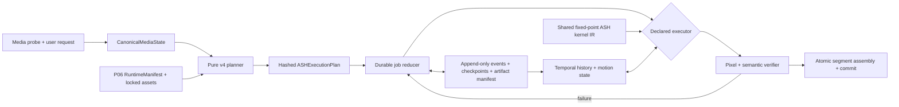

# Deterministic Engine v4 roadmap

Status: 1.3.4 (8) implementation and M7 simulator candidate selection complete

Scope: Mirmir deterministic CPU and Metal engines, media pipeline, and durable job workflow

Target qualification runtime: ASH P06

Baseline: the checked-in P05 CPU reference and Metal preview behavior before v4 work

Current checkpoint: pull requests 44 and 45 landed the v4 engine, media,
workflow, qualification tooling, and production P06 identity loading as version
1.3.0. Version 1.3.1 build 4 records the completed, simulator-only M7 scope and
its reproducible selection evidence. Version 1.3.2 build 5 hardens exact media
assembly, decoded video-range handling, and durable source-snapshot migration
after real-file testing. Version 1.3.4 build 8 admits hard-linked user sources
without relaxing private-snapshot ownership, preflights VideoToolbox Smooth
Motion against the Mac's reported 2× source-frame geometry limits, preserves
all source audio when requested, accepts legal 90 kHz NTSC cadence, and gives
every error-16 timing throw a stable site identifier. These patches do not
change the locked M7 selection result. The original 1:43 Deterministic v4 beta
source advanced through frame 8,760 in the production app without error 16,
then stopped under ENOSPC; the full output has not completed. The
resource-allocation control is deferred and is not part of version 1.3.4.
Follow-on work closed M0 through M6 in source and tests. The sealed M7 headless
XCTest frame-simulator run from commit
`ce780af87107d90142d860f328dca4a72fea3047` compared the production v4 policy
and four locked test-harness policy ablations against frozen P05, then selected
`candidate_v4`. It proved the 5% quality and 20% processing-time targets in the
same run. External devices, physical-machine matrices, signing, notarization,
stapling, shipping, and distribution are outside M7. The exact checkpoint is
recorded in `docs/v4/CURRENT_QUALIFICATION_STATUS.md`.

M7 scope alteration adopted September 21, 2026: candidate execution,
measurement, threshold evaluation, and deterministic selection in the headless
XCTest frame simulator are the complete M7 qualification. Earlier proposals for
external-device testing, a physical-machine matrix, archive signing,
notarization, stapling, shipping, or distribution are superseded and are not
M7 exit criteria.

## Executive decision

Version 4 should be built as a deterministic media system around the canonical
ASH algebra, not as another set of additions to the P05 preview paths. The
central architectural change is an immutable, hash-addressed execution plan
that is produced from a typed media description and consumed by both CPU and
Metal executors. The plan must make format, geometry, scaling, temporal,
metadata, recovery, and verification decisions explicit before pixels are
processed.

M7 is complete only when one simulated candidate satisfies both gates:

1. At least a **5% quality increase** over the frozen P05 baseline in the
   deterministic simulation corpus, including a paired-bootstrap 95% lower
   bound of at least 5%.
2. At least a **20% reduction in processing time** for total, median, and p95
   simulated engine time in the same run.

CPU/Metal parity, P06 integrity, media preservation, and recovery remain M0–M6
implementation invariants covered by their existing tests. They are not
repeated as packaging or hardware gates in M7. Shipping fitness is a separate
owner decision and is not claimed by this roadmap.

The completed run selected `candidate_v4` with a quality index of 122.792052,
a paired-bootstrap 95% lower bound of 122.312761, and total, median, and p95
processing-time ratios of 0.025213, 0.026859, and 0.030117 versus P05.

## What the research establishes

The research sources agree on a valuable separation:

- ASH supplies a finite algebra, deterministic transformations, measurement
  projection, branch aggregation, scoring, and recovery vocabulary.
- The host application supplies typed observations, operational policy,
  temporal storage, media transformations, effects, verification, and durable
  recovery.
- A plan/effect boundary prevents an executor from silently inventing policy.
- A pinned document or fixture does not prove conformance; the actual engine
  must be run against independently derived fixtures.

They also expose defects that v4 must not inherit:

| Research project | Reusable result | Important warning for v4 |
| --- | --- | --- |
| ASH Model | Canonical finite mathematics, measurement/hysteresis contract, strict decoder, depth-four branch grammar, deterministic scoring and tie-breaking | In the reference image implementation, the computed source state anchors branch labels but does not affect reconstruction or ranking. Two message controls also cancel, leaving only 12 pixel-distinct operators for 16 messages. It is a mathematical/prototyping source, not a pixel-quality oracle. |
| ASH Pattern System | Typed immutable records, stable registries, exhaustive finite tests, plan/emitter split, explicit diagnostics and recovery classes | Its composition root does not wire the whole specified system. Default validity admits all 512 states, safe halt is a record rather than an enforced runtime mode, and its three selected branch codewords have rank two, reaching only four states while allocating an exponential ternary tree. |
| Aeostara | Observe → canonicalize → plan → policy → execute → verify → recover; protocol boundaries; injected time/IDs; audit causality | The platform apps implement deterministic JSON diff/repair, not the pinned ASH lifecycle. Some conformance checks are circular, policy can fail open, critical errors are suppressed, and durability is incomplete. Version pins and passing static fixtures must never substitute for executable conformance. |

### Normative ASH mathematics

The v4 core must preserve these invariants exactly:

1. The state space is

   \[
   V=\mathbb{F}_2^9
   \]

   with coordinate 1 represented by the most-significant of the nine packed
   bits.

2. The integrity hyperplane is

   \[
   E=\{x\in V:x_9=x_1\oplus x_2\oplus\cdots\oplus x_8\},
   \]

   containing 256 states.

3. The canonical generator is

   \[
   G=\begin{bmatrix}
   1&1&1&1&0&0&0&0&0\\
   1&1&0&0&1&1&0&0&0\\
   1&0&1&0&1&0&1&0&0\\
   1&0&0&1&1&0&0&0&1
   \end{bmatrix}.
   \]

   The code \(C=\{mG:m\in\mathbb{F}_2^4\}\) is the fixed 16-member
   \([9,4,4]\) subgroup, lies in \(E\), and keeps coordinate 8 invariant.

4. A strict decode accepts only a unique codeword at distance zero or one. It
   never guesses at distance two. Across all 512 states, the canonical outcome
   counts are 16 exact, 144 corrected, and 352 rejected.

5. The action is full-state XOR, \(x\mapsto x\oplus c\). Its 32 orbits are the
   16-member cosets \(x+C\).

6. The orbit-averaging operator is

   \[
   Tf(x)=\frac{1}{16}\sum_{c\in C}f(x\oplus c),
   \]

   so it is linear, orbit-invariant, and idempotent: \(T^2=T\).

7. The canonical image projection measures eight declared signals—mean,
   contrast, edge, texture, chroma, horizontal change, vertical change, and
   temporal evidence—then derives coordinate 9 from integrity. Thresholds,
   hysteresis, measurement windows, boundary behavior, and reset rules are
   versioned parts of the runtime, not incidental constants.

8. The canonical depth-four branch grammar uses actions `0`, `+`, and `−` with
   probabilities 1/2, 1/4, and 1/4. Its 81 leaves aggregate into 16 message
   classes before reconstruction and deterministic scoring/tie-breaking.

The canonical codeword table is sorted by numeric codeword, while final ranking
ties are sorted by numeric message. P06 therefore carries explicit
message-to-codeword and codeword-to-message tables; neither ordering may be
inferred from a CSV row number.

The fixed ASH9 state must not be stretched into a generic container for HDR,
alpha, field order, scale, metadata, or queue status. Those belong in typed
media and execution-plan records. Arbitrary scale is an input to the operator
and sampling plan; temporal history is evidence used by the ASH projector and
reconstructor. Neither changes the canonical codeword set.

### Evidence in the current repository

The 1.3.0 landing closed the implementation gaps recorded when this roadmap was
proposed. The completed M7 simulation supplies the final roadmap decision:

| Area | 1.3.0 evidence | M7 simulator result |
| --- | --- | --- |
| Runtime identity | Bundled ASH P06 runtime with a hashed manifest and fail-closed loader. | The committed P06 runtime lock passed; frozen P05 source identity and run-specific executable identity both reproduced. |
| Scale | Shared fixed-point execution accepts independent rational scale factors and arbitrary integral target dimensions. | Covered by M0–M6 tests; no M7 device replay was required. |
| Temporal state | Bounded, motion-compensated history with scene/reset policy and checkpoint identity. | Full policy and temporal ablations were measured across 168 cases. |
| Backend parity | CPU and Metal consume one fixed-point contract. | Covered by M0–M6 tests; no M7 hardware matrix was required. |
| Media and workflow | Pixel formats, geometry, tracks, atomic output, durable jobs, and recovery are implemented and tested. | Packaging and shipping replay remained outside M7. |

## Measurable M7 simulator contract

### Freeze the baseline first

The M7 run must bind the comparison to reproducible simulator inputs and
execution context:

- exact committed source and tree identities with a clean tracked worktree and
  index;
- the canonical selection, quality, corpus, P05 source-manifest, and capture-
  source hashes;
- recorded macOS, Xcode/Swift toolchain, architecture, CPU model, and core
  counts as measurement context, without treating one host as a hardware
  support matrix;
- Release XCTest builds with logging and evidence serialization outside the
  timed engine calls;
- discovery and scored P05 builds that reproduce the same toolchain-specific
  application and test-executable hashes while leaving every frozen source
  identity unchanged;
- five untimed executions of each policy path, followed by one measured pass
  over every locked corpus case in a counterbalanced order;
- raw per-case engine times and independently replayed total, median, and p95
  aggregates for P05 and all five candidates.

The original M0 Debug timing figures remain historical calibration data. They
were not inputs to, and cannot substitute for, the M7 Release-mode simulation.

### Quality gate: at least 5%

The primary comparison uses only frames accepted by P05 and every v4 candidate,
so additional format support cannot inflate the score. The locked simulator
corpus contains deterministic procedural SDR sequences spanning natural detail,
text/graphics, animation, faces, low light/noise, high motion, and scene cuts.
It is intentionally a model-selection corpus, not a claim about camera-native
media or shipping readiness.

Define a preregistered weighted error `E` from normalized lower-is-better
components:

| Component | Weight |
| --- | ---: |
| Luma multiscale structural error | 0.35 |
| Chroma multiscale structural error | 0.15 |
| Perceptual feature distance | 0.20 |
| Motion-compensated temporal/flicker error | 0.20 |
| Edge displacement, ringing, and overshoot error | 0.10 |

Each component is normalized to the frozen current-engine result on the same
clip/cohort, making the baseline aggregate `E = 1`. Report the quality index as

\[
Q_{ASH}=100\left(2-E_{candidate}\right).
\]

The baseline is therefore 100 and the M7 simulator gate is at least 105. The
lower bound of a paired 95% bootstrap confidence interval must also be at least
105. The per-cohort diagnostics remain visible:

Per-cohort luma and temporal ratios remain visible diagnostics. Geometry,
alpha, range, HDR/P010, interlacing, and metadata remain exact M0–M6 conformance
tests rather than weighted simulator points. The scored output must come from
the declared deterministic backend with no hidden Apple-backend substitution.

Matched ablations are reported beside the score: uniform versus
state-conditioned priors, real versus randomized ASH state/message assignment,
temporal hysteresis on/off, and motion/history policy on/off. This separates the
quality contribution of ASH policy from improvements made only by a stronger
operator bank.

Metric implementations, model versions, corpus hashes, crop/border rules, and
normalization constants are themselves locked simulation artifacts.

### Processing-time gate: at least 20%

For every simulated candidate, compute

\[
R_T=\frac{T_{v4}}{T_{baseline}}.
\]

Aggregate simulated engine time, median frame time, and p95 frame time must all
satisfy `R_T ≤ 0.80`. P05 and every candidate run in the same headless XCTest
simulation with identical inputs, target sizes, warmups, and process scope.
This is a paired candidate-selection measurement; it does not assert a physical
device or end-to-end shipping benchmark.

The simulator records engine processing only. Decode, encode, queue journaling,
metadata copying, signing, and publication are outside the revised M7 scope.

## Target architecture



### 1. `CanonicalMediaState`

Probe once and construct one immutable, typed record containing:

- ordered track identities and enabled states;
- encoded and presentation raster, preferred transform, clean aperture, and
  rational pixel aspect ratio;
- pixel format, bit depth, range, chroma subsampling/siting, alpha model, and
  premultiplication state;
- color primaries, transfer function, matrix, mastering-display and
  content-light metadata, and dynamic HDR metadata when present;
- field count, dominance, cadence, rational timebase, edit lists, and duration;
- audio, subtitle, caption, chapter, timecode, and auxiliary metadata tracks;
- stable input hashes and a security-scoped bookmark reference.

Malformed, contradictory, unknown, and unsupported observations remain typed
diagnostics. They are not converted to `nil`, generic dictionary keys, or a
silent default.

### 2. Pure `ASHCoreV4`

Keep the finite core synchronous, immutable, and independent of AVFoundation:

- packed `ASHState9` and `ASHMessage4` values;
- the exact fixed generator/codeword constants;
- precomputed strict decode, orbit, representative, and 512×16 transition
  tables;
- orbit averaging implemented once per orbit;
- exhaustive algebraic fixtures and independently generated certificates;
- separate types for algebraic well-formedness, operational admission, runtime
  health, and recovery state.

Strict affine decoding is used when a state/codeword crosses a transport,
checkpoint, or other validation boundary. A hot path that already owns the
canonical message should not decode its own known branch label merely to match
an architectural diagram.

The 1.3.0 landing includes the immutable 512-entry strict-decode table and
the remainder of the pure core: packed states, fixed generator and codeword
constants, exhaustive certificates, and separate algebraic, admission, health,
and recovery types.

### 3. Versioned measurement and policy projection

`ASHMeasurementContract` maps typed, normalized image evidence to the canonical
nine bits. It freezes windows, border extension, fixed-point precision,
thresholds, hysteresis, color-domain conversions, temporal evidence, reset
conditions, and tie-breaking.

The plan stores the contract ID and hash. CPU and Metal do not maintain separate
threshold implementations. State must materially condition candidate weights,
operator choice, or scoring; tests must fail if feature/state changes leave all
rankings and pixels invariant.

The plan also declares the final output rule—fixed top-1 selection or a
specified fixed-point blend. Returning an ordered top-k candidate list without
defining which pixels are emitted is not a complete engine contract.

The depth-four grammar should be compiled offline into a rank-checked,
hash-consed DAG or directly into aggregated message weights. Runtime code must
not allocate an exponential tree per tile. All 16 messages must either have a
declared distinct effect or be intentionally coalesced in the locked operator
manifest.

### 4. Arbitrary rational scale

Scale is represented per axis as a reduced rational derived from source and
target rasters. For destination center `j`, the source-center coordinate is
computed exactly as

\[
p(j)=\frac{(2j+1)S-T}{2T},
\]

where `S` and `T` are the source and target extents. The planner stores the
integer base sample and reduced phase remainder, avoiding backend-dependent
floating coordinate drift.

Offline tooling generates or validates a bounded polyphase/operator bank.
Unseen rational phases are generated deterministically from the locked P06
coefficient procedure during planning, then hashed into the execution plan.
Both axes may differ. The product remains an upscaler by policy, but the ASH
kernel is no longer limited to 2× or 3:2.

### 5. Shared fixed-point kernel IR and backend parity

CPU and Metal consume the same ordered operations, coefficients, normalization,
clamp points, and round-to-nearest/tie rule. Integer accumulators are sized from
proved bounds. The Metal compiler uses the locked settings recorded in the
runtime manifest.

Parity is checked before encoding:

- exact visible bytes for every plane;
- exact attachment semantics;
- stride/padding adversaries and odd legal dimensions;
- NV12 full/video range, P010, alpha planes, every rational phase, temporal
  resets, and scene cuts;
- repeated runs, cross-process runs, and deterministic tile scheduling.

If a stage cannot meet byte parity, it is not part of the deterministic v4
route until it is converted to the shared integer contract. A floating-point
tolerance is useful for exploratory comparison but is not the final v4 claim.

### 6. Temporal ASH reconstruction

Temporal state is an ordered external record, not extra canonical ASH bits. A
bounded tile history stores frame identity, rational PTS, normalized samples,
motion vectors, confidence, prior ASH state, and scene/cadence status.

The first implementation should use deterministic fixed-point block matching
with a fixed search window and a total tie order such as `(cost, |dx| + |dy|,
dy, dx)`. Motion-compensated residual and confidence feed the canonical
temporal measurement; aligned history contributes to candidate scoring and
reconstruction. Scene cuts, seeks, gaps, format changes, field discontinuities,
and checkpoint incompatibility reset history and use the spatial fallback.

Tests must prove that:

- history changes decisions on declared temporal fixtures;
- a reset produces exactly the declared spatial result;
- no future frame is observed;
- CPU and Metal use identical motion/tie decisions;
- resumed processing restores the same bounded history and pixels as an
  uninterrupted run.

### 7. Durable job reducer

Use a single enforced transition reducer, not independent UI booleans:

```text
queued → probing → planned → running ↔ pausing → paused
       → verifying → committing → completed
       → recovering → contained → failed / safe-halt
```

Every accepted transition appends an ordered event carrying job/attempt ID,
event ordinal, previous-event hash, plan hash, runtime hash, input/output hashes,
diagnostic parents, and checkpoint/artifact references. Illegal transitions,
especially after a terminal state, fail closed.

Pause/resume operates at independently decodable segment boundaries. A
monolithic in-progress `.mov` is not treated as safely resumable. Each
checkpoint atomically commits:

- last completed input and output timestamp/frame;
- segment hashes and codec settings;
- temporal history and ASH hysteresis state;
- track/metadata progress;
- plan/runtime identity and security bookmark references.

At launch, the job store activates the relevant bookmarks and reconciles every
registered partial artifact. A compatible job resumes from its last committed
segment; an invalid or obsolete artifact is quarantined or removed according to
explicit policy and recorded as an event. No `.partial.mov` is left as an
unowned hidden file.

## Limitation-to-delivery matrix

| Required limitation | v4 implementation | Release evidence |
| --- | --- | --- |
| P010 / 10-bit HDR | Native bi-planar 10-bit ingest, fixed-point processing at retained precision, 10-bit-capable encode, and full static/dynamic HDR attachment migration. Preserve HDR by default; tone mapping is a separately named optional route, never silent. | Code-value fixtures, PQ/HLG ramps, BT.2020 matrix cases, mastering/CLL round trips, no 8-bit intermediate, readable output. |
| Interlaced video | Field-aware normalization before spatial/temporal ASH; explicit dominance and cadence; deterministic motion-adaptive deinterlacing to progressive output. | TFF/BFF, cadence change, combing, field timestamp, scene-cut, and CPU/Metal fixtures. |
| Non-square pixels | Rational presentation geometry in the plan; scale raster and sample aspect ratio deliberately, preserving display aspect exactly. | SAR round trips and display-geometry equality across portrait/rotation cases. |
| Clean aperture | Compose clean-aperture, preferred-transform, SAR, and scale matrices with rational arithmetic; update aperture metadata or explicitly bake the crop. | Edge/crop fiducials and exact output aperture checks. |
| Alpha video | Typed straight/premultiplied alpha; 4:4:4:4 working/output formats; color reconstruction separated from declared alpha preservation/enhancement; compatible codec such as ProRes 4444. | Transparent-edge, zero-alpha color, premultiplication, alpha byte/parity, and codec fixtures. |
| Multiple enabled video tracks | Ordered per-track plan. Each enabled track receives an explicit process, transcode, pass-through, or user-approved drop action; the default is preservation, not first-track-only selection. | Multi-angle/alternate-video fixtures, ordering, timing/edit-list, and no-unplanned-drop checks. |
| Full metadata and auxiliary tracks | Build a track graph and migrate all audio, subtitle, caption, chapter, timecode, timed metadata, and auxiliary tracks. Transcoding is explicit when pass-through is impossible. | Track-count/type/order/language/role, sample timing, chapter, timecode, caption, and metadata semantic comparisons. |
| Arbitrary ASH scale | Exact rational coordinate/phase plan and deterministic coefficient generation for arbitrary target width/height within codec/hardware limits. | Coprime, fractional, anisotropic, odd-dimension, 1.5×, 2× compatibility, border, and parity corpus. |
| Temporal reconstruction | Motion-compensated bounded history, canonical temporal evidence, scene/reset policy, temporal scoring/reconstruction, spatial fallback. | Motion, occlusion, repeated pattern, scene-cut, cadence, seek, and resume-identity corpus; ≥5% quality gate. |
| CPU/Metal pixel parity | Shared fixed-point kernel IR, coefficients, rounding, clamps, scheduling-independent reductions. | Byte equality for visible planes across the full conformance matrix and repeated/cross-process runs. |
| P06 release lock | Reproducible signed/hashed runtime manifest containing measurement schema, operator bank, LUTs, code certificates, Metal library/compiler identity, and corpus IDs; verified at load. | Clean-build reproduction, tamper/failure tests, artifact hash match, no shipping P05/development identity. |
| Persistent batch queue | Durable ordered jobs with canonical request/plan/runtime data, security bookmarks, attempts, priorities, and terminal history. | Kill/relaunch ordering, schema migration, corrupt-ledger containment, bookmark denial, and multi-job tests. |
| Pause and resume | Segment checkpoints including temporal/hysteresis state and exact track progress; deterministic final assembly. | Pause at every boundary and compare final pixels/tracks/hashes semantically with uninterrupted output. |
| Crash recovery | Registered artifact manifest and launch reconciliation; resume compatible work, quarantine/report invalid work, remove confirmed orphans. | Forced termination before/after every event/checkpoint/commit, disk-full, partial-write, and stale-artifact tests. |

## Delivery sequence

The milestones are ordered by dependency rather than calendar date. Media and
workflow lanes can proceed in parallel after the plan schema is frozen.

### M0 — Baseline and executable evidence

Status: landed in 1.3.0

Deliver:

- locked input corpus and independently versioned metric tools;
- Release benchmark harness and baseline manifest;
- current CPU/Metal output corpus and difference maps;
- full ASH algebra certificate tests;
- profiler traces identifying hot kernels, copies, allocations, and
  decode/encode boundaries.

Exit: the baseline can be recreated from a clean checkout on the reference
machine, and CI rejects missing corpus/runtime identities.

### M1 — Semantic spine and P06 artifact pipeline

Status: landed in 1.3.0

Deliver:

- `CanonicalMediaState`, `RuntimeManifest`, `ASHExecutionPlan`, verification
  plan, canonical JSON encoding, and SHA-256 plan identity;
- pure `ASHCoreV4` with fixed constants and exhaustive certificates;
- one P06 build tool that produces all runtime artifacts and provenance;
- loader that verifies every schema/hash and fails closed;
- one canonical diagnostic/event envelope with stable ordering.

Exit: a request produces the same plan hash across processes; tampered or
incomplete runtime assets cannot prepare an engine.

### M2 — Spatial v4, arbitrary scale, parity, and hot-path efficiency

Status: implementation landed in 1.3.0; M7 simulator processing-time comparison passed

Deliver:

- exact rational geometry and phase planner;
- shared fixed-point kernel IR and CPU reference executor;
- Metal executor consuming the same IR/artifacts;
- offline branch aggregation/rank checks and distinct-operator audit;
- fused analysis/selection/reconstruction kernels, reusable buffers, bounded
  tile pipeline, cached Metal state, and ordered deterministic reduction.

Implementation exit: arbitrary-scale conformance, byte parity, and bounded
hot-path behavior pass their repository tests. M7 separately closes the
roadmap processing-time objective when the selected candidate's total, median,
and p95 ratios are all at most 0.80 on the complete locked simulation corpus.

### M3 — Temporal quality

Status: implementation landed in 1.3.0; M7 simulator quality comparison passed

Deliver:

- deterministic motion analysis, confidence, scene/cadence detection, and
  history reset contract;
- temporal measurement, state-conditioned scoring, reconstruction, and spatial
  fallback;
- bounded history serialization for checkpoints;
- quality calibration tools that never enter the release runtime.

Implementation exit: temporal state, reset, fallback, and resume identity pass
their repository tests. M7 separately closes the roadmap quality objective when
the selected candidate's `Q_ASH` point estimate and lower confidence bound are
both at least 105; per-cohort temporal ratios remain reported diagnostics.

### M4 — Pixel formats and presentation geometry

Status: landed in 1.3.0

Deliver:

- P010/HDR path and HDR metadata migration;
- deterministic field-aware deinterlacing;
- rational SAR/clean-aperture/transform composition;
- straight/premultiplied alpha and alpha-capable output path;
- format-specialized buffer pools without unconditional full-frame bridges.

Exit: all format/geometry rows in the delivery matrix pass pairwise and
mandatory combined fixtures with no silent tone map, crop, alpha loss, or
precision reduction.

### M5 — Track graph and metadata preservation

Status: landed in 1.3.0

Deliver:

- ordered multi-video-track processing plan;
- alternate audio, subtitles, captions, chapters, timecode, timed metadata, and
  auxiliary-track migration;
- explicit compatibility/transcode/drop policy and semantic output verifier.

Exit: the verifier accounts for every enabled input track and metadata group;
any loss requires an explicit plan action and user consent.

### M6 — Durable queue, pause/resume, and crash recovery

Status: landed in 1.3.0

Deliver:

- append-only job/event store with atomic snapshots and migrations;
- security bookmark lifecycle and input TOCTOU revalidation;
- segment/checkpoint writer and deterministic final assembly;
- launch reconciliation, quarantine, orphan cleanup, and recovery UI;
- fault injection at every durable boundary.

Exit: forced termination at every injected point produces either an identical
resumed output or an explicit contained failure with no unowned artifacts.

### M7 — Simulator candidate selection

Status: complete — `candidate_v4` selected from sealed simulator evidence

Deliver:

- one deterministic procedural frame corpus and frozen P05 baseline;
- the production v4 policy plus four locked test-harness policy ablations;
- per-candidate quality reports with paired-bootstrap confidence intervals;
- paired total, median, and p95 processing-time ratios;
- a deterministic ranking, selected candidate, and sealed evidence receipt.

Exit: one candidate clears both numerical targets, the selector names it as the
best eligible candidate under the locked ordering, and independent replay
reproduces the decision. This completes M7 but does not assert notarization,
shipping readiness, or distribution.

Current M7 state:

- all five policies ran over 168 cases from 28 clips and seven cohorts;
- every candidate passed the quality and total/median/p95 processing-time gates;
- `candidate_v4` ranked first under the locked confidence-first ordering;
- the source-frozen P05 executable and candidate capture source reproduced under
  the recorded toolchain without changing their canonical identities;
- independent replay verified 1,372 sealed artifacts and reproduced the winner.

## Implementation status

Pull request 43 established the algebraic foundation and this roadmap. Pull
request 44 landed the v4 engine, media pipeline, durable workflow, and
qualification tooling as version 1.3.0:

- strict ASH decoding uses one immutable 512-entry lookup table, with exhaustive
  16/144/352, two-bit rejection, and affine single-bit recovery proofs;
- the prepared CPU adapter actor-isolates lifecycle state, supports idempotent
  finish, and rejects later frames just as the Metal adapter does;
- `CanonicalMediaState`, `ASHExecutionPlan`, and the hashed P06 runtime
  manifest are produced before pixels are processed;
- CPU and Metal consume one shared fixed-point contract for arbitrary integral
  geometry, temporal reconstruction, NV12, P010/HDR, interlacing, and alpha;
- the application queue is durable, bookmark-backed, pauseable, and recoverable;
- product support and the README describe the P06 contract rather than the P05
  preview routes.

Pull request 45 then bound the identity workflow to the committed P06 bundle:
the load check now receives the domain-separated manifest identity, source
revision, and builder hash instead of invoking the helper with no trust roots.

These changes close M0 through M6 in source. The later committed-source M7 run
then satisfied the simulator quality, processing-time, and best-candidate
selection gates, completing this roadmap within its declared scope.

Version 1.3.2 then corrected post-qualification conformance defects exposed by
real-file testing: exact processed-video media origin and movie timescale
preservation, AAC MP4-to-MOV semantic comparison, decoded cadence handling,
video-range footroom/headroom policy, destination-directory identity binding,
durable source-basename migration, and idle dispatcher-slot contention during
paused-job resume. The canonical P06 builder also refreshed its stale
quality-evaluator source lock and reproduced the current 12-artifact bundle in
two independent builds. These corrections strengthen the M1 and M4–M6 exit
invariants; they do not broaden M7 or replace its sealed candidate result.

## Risks and decisions that must remain explicit

- **Calibration boundary:** offline corpus, metric, and tuning tools never enter
  the P06 execution runtime or mutate release assets at runtime. Dormant
  exact-candidate qualification observers may ship so matched ablations execute
  inside the candidate binary, but they remain isolated from normal UI and job
  policy.
- **Quality metric gaming:** corpus, metrics, weights, borders, and exclusions
  are frozen before calibration. Per-cohort non-regression gates remain visible.
- **Deterministic concurrency:** jobs, frames, and tiles may run concurrently,
  but task completion order never chooses IDs, output order, reductions, or
  diagnostic order.
- **Codec resumability:** checkpoints use independently committed segments.
  They do not claim that an arbitrary interrupted AVAssetWriter movie can be
  reopened safely.
- **Security scope:** recovery requires durable bookmarks and explicit access
  failure handling. Startup code must not scan arbitrary user directories.
- **Media preservation:** unsupported pass-through or transcoding is surfaced
  during planning. There is no silent track drop, HDR tone map, alpha removal,
  deinterlace, or backend fallback.
- **Canonical boundary:** ASH mathematics, media semantics, operational policy,
  and workflow state have separate types and versions. Similar vocabulary does
  not make them the same state machine.

## Research provenance

Primary research material reviewed:

- `mirmir-research/ASH-Model-main/docs/canonical-computational-specification.md`
- `mirmir-research/ASH-Model-main/docs/mirmir-integration.md`
- `mirmir-research/ASH-Model-main/ash_model/`
- `mirmir-research/ASH-Pattern-System-Mac-iOS-main/specs/`
- `mirmir-research/ASH-Pattern-System-Mac-iOS-main/MaciOS/Sources/`
- `mirmir-research/ASH-Pattern-System-Mac-iOS-main/MaciOS/Tests/`
- `mirmir-research/Aeostara-Mac-iOS-main/`, including its pinned v1.0.0 base
  and isolated `platform/macos` and `platform/ios` histories

The roadmap treats the canonical ASH specification as mathematical authority,
uses the other projects as software-architecture evidence, and explicitly does
not inherit contradictions or incomplete implementations from any one project.
