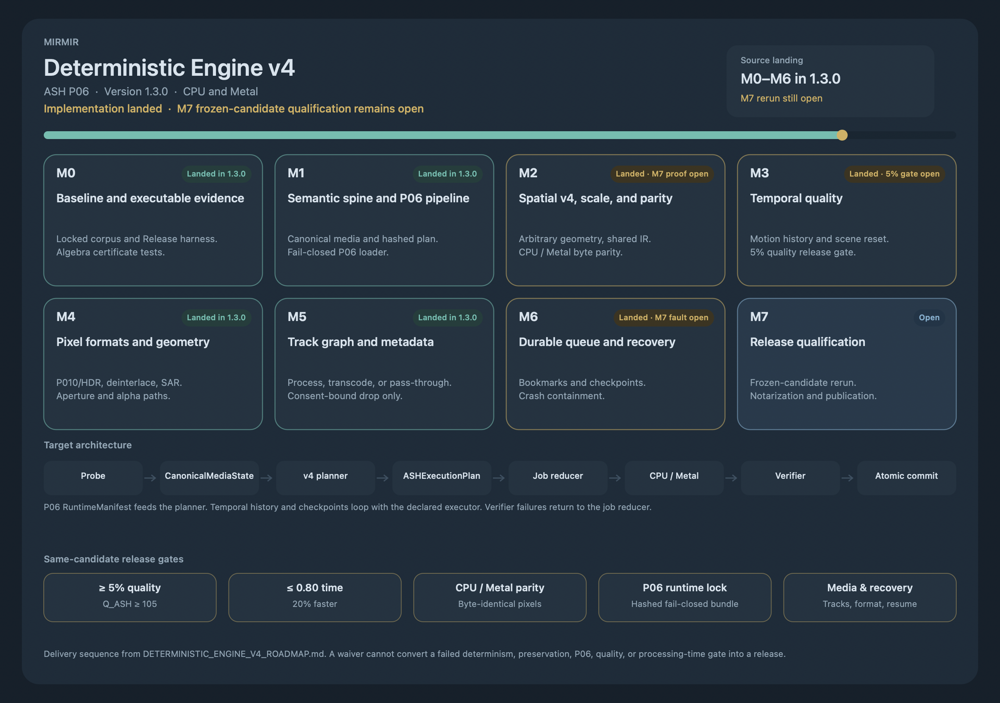

# Mirmir


Mirmir is a native macOS video upscaler built for explicit, local processing.
Version 1.3.0 lands the deterministic ASH P06 CPU and Metal engine beside the
supported Apple scaling frameworks, while keeping every backend choice,
preservation decision, and fallback boundary visible to the user.

The current application version is recorded in [`VERSION`](VERSION). Release
packaging, signing, notarization, and publication remain manual operations.

## Highlights

- Midnight Nordic interface with an interactive before-and-after comparison
  viewer for completed jobs.
- Branded Dashboard and About surfaces with live, app-specific CPU, memory, and
  disk telemetry plus truthful explicit Metal-route activity.
- Deterministic CPU and Metal ASH P06 routes for arbitrary integral target
  dimensions, with one canonical fixed-point plan and no silent backend
  substitution.
- Native 8-bit NV12 and 10-bit P010/HDR processing, field-aware deinterlacing,
  rational sample-aspect/clean-aperture geometry, and ProRes 4444 alpha output.
- State-conditioned spatial reconstruction plus bounded, motion-compensated
  temporal history with deterministic checkpoint restoration.
- Explicit Apple-native choices using VideoToolbox, MetalFX, Metal Performance
  Shaders, Core Image, Accelerate/vImage, and pixel transfer where available.
- HEVC, H.264, Apple ProRes 422, and alpha-capable Apple ProRes 4444 output in
  a QuickTime movie container.
- Ordered video, audio, subtitle, caption, chapter, timecode, timed-metadata,
  and auxiliary tracks are planned explicitly and preserved or transcoded
  according to a verified whole-asset plan.
- Durable bookmark-backed batch jobs survive relaunch. Pause/resume uses
  segment and temporal checkpoints; launch recovery contains corrupt work and
  reconciles registered partial artifacts.
- Output is semantically validated before atomic publication; cancellation,
  failure, and crash recovery account for temporary artifacts explicitly.

See [`PRODUCT_SUPPORT.md`](PRODUCT_SUPPORT.md) for exact backend contracts,
availability requirements, media behavior, and current limitations.
See [`CHANGELOG.md`](CHANGELOG.md) for the 1.3.0 landing record and
[`docs/v4/`](docs/v4/) for the qualification evidence contracts.
The [Mirmir Wiki](https://github.com/flynn33/Mirmir/wiki) provides the complete
product guide, architecture reference, ASH engine documentation, diagrams,
testing procedures, and troubleshooting material.

## Deterministic Engine v4



The [`DETERMINISTIC_ENGINE_V4_ROADMAP.md`](DETERMINISTIC_ENGINE_V4_ROADMAP.md)
records the v4 architecture, delivery sequence, and remaining M7 release gates
for at least 5% higher quality and 20% lower processing time. Engine, media,
and durable-workflow implementation is in 1.3.0; frozen-candidate qualification
and operator publication remain open.

## Requirements

- macOS 15.4 or later
- Xcode 26 or later
- A Metal-capable Mac for GPU-backed processing routes

Some VideoToolbox enhancement routes require macOS 26 or later and may require
an Apple-managed model download. The application reports unavailable routes and
their reasons without silently selecting a different method.

## Build and run

Open `Mirmir.xcodeproj` in Xcode and run the `Mirmir` scheme, or use:

```bash
./script/build_and_run.sh
```

The helper also supports `--debug`, `--logs`, `--telemetry`, and `--verify`.

To build without launching the application:

```bash
xcodebuild \
  -project Mirmir.xcodeproj \
  -scheme Mirmir \
  -configuration Debug \
  -destination 'platform=macOS' \
  build
```

## Test

```bash
xcodebuild \
  -project Mirmir.xcodeproj \
  -scheme Mirmir \
  -configuration Debug \
  -destination 'platform=macOS' \
  test
```

Version tooling can be checked independently on any machine with Python 3:

```bash
python3 script/update_version.py --check
python3 script/test_update_version.py
```

Checked-in v4 identities can be replayed the same way:

```bash
python3 script/v4/test_p06_source_identity_v4.py
python3 script/v4/test_repository_identity_v4.py
python3 script/v4/repository_identity_v4.py --repository "$PWD"
```

The `Verify deterministic v4 identities` workflow also loads
`Mirmir/Resources/ASH-P06.bundle` through
`script/v4/run_p06_runtime_load_check.sh`. It computes the domain-separated
manifest identity and reads the manifest provenance source revision and builder
hash, then passes those four arguments into the production loader. A bundle
that does not match the declared trust roots cannot pass CI.

See [`CHANGELOG.md`](CHANGELOG.md) for the current unreleased identity-check
record.

## Versioning

Mirmir uses `release.feature.patch` versions. Exactly one version label may be
applied to a same-repository pull request:

| Pull-request label | Result from `1.2.3` |
| --- | --- |
| `release` | `2.0.0` |
| `feature-release` | `1.3.0` |
| `patch/hotfix` | `1.2.4` |
| No version label | No increment (`1.2.3`) |

The pull-request version workflow calculates the target from the base branch,
updates `VERSION` and every Xcode `MARKETING_VERSION` setting, validates the
result, and commits the change to the pull-request branch. Repeated runs resolve
to the same target rather than incrementing again. Conflicting version labels
fail the workflow. Fork pull requests are never given write access.

`CFBundleShortVersionString` is sourced from `MARKETING_VERSION`, and
`CFBundleVersion` remains the separate Xcode build number.

Notable changes are recorded in [`CHANGELOG.md`](CHANGELOG.md).

## License and model notices

Mirmir includes separately governed deterministic ASH model material. Its
license is bundled at `Mirmir/Resources/Legal/ASH-Model-LICENSE.txt` and must
remain present in application distributions.
