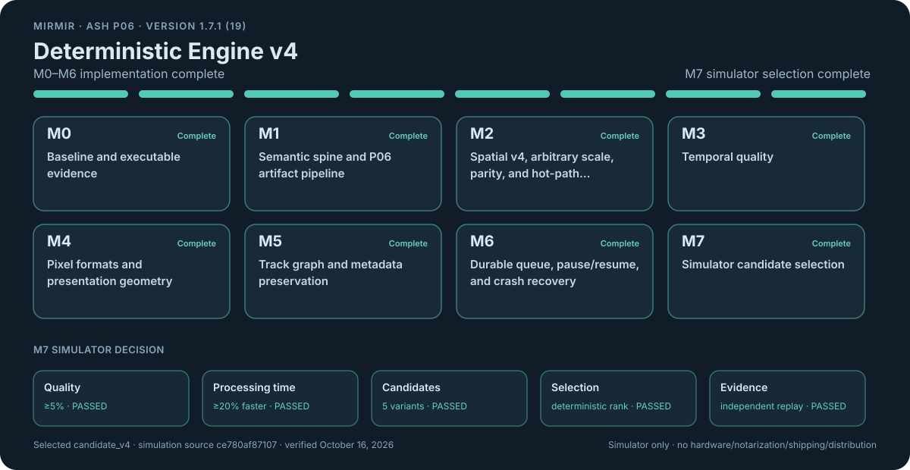

# Mirmir


Mirmir is a native macOS video upscaler built for explicit, local processing.

The current marketing version and build number are recorded in [`VERSION`](VERSION) and [`BUILD_NUMBER`](BUILD_NUMBER), then synchronized with Xcode. Release packaging, signing, notarization, and publication remain deliberate operator actions.

## Table of contents

- [Current release](#current-release)
- [Highlights](#highlights)
- [Product boundaries](#product-boundaries)
- [Documentation](#documentation)
- [Verification and qualification](#verification-and-qualification)
- [Deterministic Engine v4](#deterministic-engine-v4)
- [Requirements](#requirements)
- [Build and run](#build-and-run)
- [Test](#test)
- [Development diagnostics](#development-diagnostics)
- [Versioning](#versioning)
- [License and model notices](#license-and-model-notices)

## Current release

**Version 1.7.1 build 19** adds **Window > Show Main Window** (**Command-0**) to reopen the workspace after closing it or bring it forward when already open. Native menu lifecycle verification passed; see [`docs/WINDOW_LIFECYCLE.md`](docs/WINDOW_LIFECYCLE.md) for the review issue and verification results and procedure.

This patch retains:

- The 1.7.0 deterministic finish-stage assembly and whole-asset migration repairs
- Bounded parallel spatial conditioning on both deterministic routes

Workers own disjoint row stripes and bounded scratch; immutable boundary rows preserve the serial integer stencil and rounding.

At 3840×1632, the measured spatial-stage median fell from 91.325 to 10.248 ms with 14 workers across five alternating pairs after warmup—an **8.91×** improvement with identical pixels and controls. This measures that stage; full-movie completion time remains unqualified. See [`docs/DETERMINISTIC_SPATIAL_PARALLELISM.md`](docs/DETERMINISTIC_SPATIAL_PARALLELISM.md) for implementation, strict parity coverage, and verification limits, and [`docs/v4/CURRENT_QUALIFICATION_STATUS.md`](docs/v4/CURRENT_QUALIFICATION_STATUS.md) for current results and remaining qualification work.

### What 1.7.1 build 19 carries forward

Version 1.7.1 build 19:

- Carries the deterministic ASH P06 CPU and Metal engine beside the supported Apple scaling frameworks
- Preserves the completed simulator-only M7 candidate selection
- Adds qualified source admission, VideoToolbox capability checks, multi-audio preservation, and deterministic timing diagnostics
- Keeps every backend choice, preservation decision, and fallback boundary visible
- Separates live Upscale processing from the independent Compare player
- Permits authenticated failed jobs to resume from their last verified nonterminal checkpoint

Settings can place the durable job cache on user-selected storage and remove inactive job data without touching completed destination movies.

Version 1.4.3 connects the development diagnostic exports to the workspace, keeps exactly representable media times exact when a distinct container boundary is also present, and preserves one-member audible selection groups in conventional output.

### October 7 finish-stage repair

The October 7 finish-stage repair recovered the complete saved deterministic Metal job:

- **148,176 video frames**
- **Two audio tracks**
- **14 chapters**
- Resolution: 3840×1632

Production finalization and independent packet, timing, metadata, and complete decoded-audio checks passed. The signed universal **1.7.0 (17)** repair was installed and launched on October 7; the About surface confirmed the version and build. Original source, checkpoint, cache, and app backups remain preserved. The historical queue entry remains contained. Recovery reused the completed GPU cache; a fresh full GPU render was not repeated.

See [the repair details](docs/DETERMINISTIC_FINALIZATION_REPAIR.md) and [portable verification receipt](docs/v4/evidence/end-finalization-repair-2026-10-07/README.md).

## Highlights

- Midnight Nordic interface with an interactive before-and-after comparison viewer for completed jobs.
- Branded Dashboard and About surfaces with live, app-specific CPU, memory, and disk telemetry plus truthful explicit Metal-route activity.
- Deterministic CPU and Metal ASH P06 routes for arbitrary integral target dimensions, with one canonical fixed-point plan and no silent backend substitution.
- Native 8-bit NV12 and 10-bit P010/HDR processing, field-aware deinterlacing, rational sample-aspect/clean-aperture geometry, and ProRes 4444 alpha output.
- State-conditioned spatial reconstruction plus bounded, motion-compensated temporal history with deterministic checkpoint restoration, parallel spatial stripes, and parallel motion block searches. Frames and history stay ordered; active processing remains protected from App Nap.
- Explicit Apple-native choices using VideoToolbox, MetalFX, Metal Performance Shaders, Core Image, Accelerate/vImage, and pixel transfer where available.
- HEVC, H.264, Apple ProRes 422, and alpha-capable Apple ProRes 4444 output in a QuickTime movie container.
- Ordered video, audio, subtitle, caption, chapter, timecode, timed-metadata, and auxiliary tracks are planned explicitly and preserved or transcoded according to a verified whole-asset plan.
- When audio preservation is enabled, conventional and Deterministic v4 jobs keep every source audio track and validate language, enabled/default state, and alternate-group topology, including one-member audible selection groups, after writing.
- Durable bookmark-backed batch jobs survive relaunch. Pause/resume uses segment and temporal checkpoints; launch recovery contains corrupt work and reconciles registered partial artifacts.
- Settings can place the durable job cache on a user-selected local folder, mounted drive, or mounted share. Users can delete individual jobs, delete finished or unfinished jobs in bulk, or clear all inactive job and temporary cache data without deleting completed output movies.
- Output is semantically validated before atomic publication; cancellation, failure, and crash recovery account for temporary artifacts explicitly.
- A single persistent development journal records backend selection, media geometry and format, exact sample timing, durable checkpoint state, disk and volume facts, opened audio topology, nested errors, source locations, and bounded process telemetry. Diagnostics exports the journal as JSON or Markdown and the current process's available unified logs as JSON.

## Product boundaries

Version 1.7.1 keeps these product boundaries explicit:

- Deterministic resource allocation is not a first-release target. It is excluded from version 1.4.0 rather than treated as unfinished release work.
- A user-selected regular source may have multiple hard links; the queue still creates and validates a private single-link snapshot.
- Smooth Motion + Spatial Upscale is available only when the Mac's VideoToolbox 2× source-frame geometry limits admit the input. Those limits are independent of display resolution. Automatic pre-scale and post-scale geometry adaptation is post-first-release work; truthful unavailability is the version 1.4.0 contract.
- Attached-picture preservation is provided by the deterministic v4 whole-asset path; conventional backends do not preserve attached pictures.
- Automatic does not select deterministic v4 for opaque H.264 input.
- Deterministic timing reconstructs nominal frame starts on the exact `1001/24000` lattice. The shared source-clock conversion policy returns every exactly representable value directly. Only an incommensurate value can use an independently admitted immediate floor or ceiling tick; a nonadjacent boundary fails under forensic site 057. The durable coordinator separately inventories encoded primary-video samples and requires the terminal decoded ordinal to account for all of them before finalization. Historical recovery evidence recorded 148,140 committed Ferris video frames and a 36-frame terminal remainder. On October 1, the owner authorized clearing that job's live cache with the other inactive jobs. Its checkpoint and cached segments are no longer present. Source and fixture qualification do not claim that job completed. A later, separate saved job completed all 148,176 GPU frames and was fully finalized by the October 7 repair described above.

## Documentation

| Document | Contents |
| --- | --- |
| [`PRODUCT_SUPPORT.md`](PRODUCT_SUPPORT.md) | Exact backend contracts, availability requirements, media behavior, and current limitations |
| [`KNOWN_ISSUES.md`](KNOWN_ISSUES.md) | Accepted first-release limitations and post-first-release qualification and enhancement work |
| [`CHANGELOG.md`](CHANGELOG.md) | 1.7.1 main-window correction; 1.7.0 deterministic finalization repair and parallel spatial conditioning; 1.6.0 parallel motion and processing activity; 1.5.0 diagnostic and engine efficiency update; 1.4.3 timing, diagnostics, and singleton-audio corrections; 1.4.2 cache-control correction; 1.4.1 timing correction; 1.4.0 cache-management release; 1.3.4 recovery and comparison updates; 1.3.3 source-admission and capability corrections; earlier conformance and qualification updates |
| [`docs/v4/`](docs/v4/) | Qualification evidence contracts |
| [`docs/CACHE_MANAGEMENT.md`](docs/CACHE_MANAGEMENT.md) | Cache ownership, location changes, unavailable-root recovery, and deletion safety |
| [Mirmir Wiki](https://github.com/flynn33/Mirmir/wiki) | Complete product guide, architecture reference, ASH engine documentation, diagrams, testing procedures, and troubleshooting |

## Verification and qualification

### Final finish-stage repair (October 7, 2026)

- Native My Mac Debug: **658 passed, zero failed, 12 explicit opt-in skips**.
- Fresh publication Release: **653 passed, zero failed, 13 opt-in skips**, with no reported runtime warnings.
- The complete migration suite separately passed **102 of 102** with no skips.
- The full saved-source production-finalization test passed in **266.697 seconds**, accepting the original plan and runtime binding unchanged. Every source/output stream identity and normal completion inspection passed.
- The signed universal Release build succeeded with warnings treated as errors, zero compiler warnings/errors, and strict signature verification. The installed executable matches that built app; native UI readback confirms 1.7.0 / 17 and an idle, ready Metal route.
- Independent verification covers every video and audio packet, exact stored clocks and edits, both audio names, 14 chapters, complete decoded audio PCM, and native frame extraction at beginning, middle, and end. QuickTime opens the published movie and displays a decoded scene after seeking.

These results establish saved full-job finalization and the installed repair's identity. Fresh full GPU processing, matched whole-movie throughput, continuous playback, and audible speaker playback were not exercised. The earlier Release decoded-parity incident and runtime source-identity gate remain open.

### Retained spatial-candidate evidence (October 7, 2026)

Retained before the 1.7.0 version alignment:

- Native Debug: **635 passed, zero failed, six opt-in skips**.
- Native Release: **630 passed, one failed, five opt-in skips**. The strict decoded H.264 parity test failed in that run: all 156 pre-encoder frames match, while 25 decoded ordinals differ. Four traced repeats matched; the cause remains unknown.
- Forced serial/parallel tests compare every pixel and spatial control against an independent reference, including all 256 ASH states, stripe boundaries, invalid inputs, cancellation, reused scratch, concurrent calls, and movie geometries. No quality or parity assertion was relaxed.
- A separately identified, unsealed development capture reproduced all 840 baseline candidate/ablation artifacts and its quality results. Its 64×48 frames use the serial path; it neither qualifies the parallel path nor replaces the historical sealed M7 selection.
- The packaged runtime source-identity gate still exits 2. A runtime-production attempt stopped at stale frozen capture-observer locks, with 16 of 17 checks passing. Existing runtime assets, trust constants, and historical seals remain unchanged. Current runtime-source closure remains open.

See the [current status](docs/v4/CURRENT_QUALIFICATION_STATUS.md).

### Spatial-publication builds (1.7.0 build 17)

Earlier spatial-publication 1.7.0 build-17 Debug and Release test builds and the universal production Release build succeeded with zero compiler warnings or errors. The signed app reports 1.7.0 (17), keeps `com.mirmir.app`, contains arm64 and x86_64, and passes strict/deep signature verification.

The actual repository project also built successfully in Xcode for **Any Mac (arm64, x86_64)** at 2:04 PM on October 7, with an empty unfiltered Issue Navigator. These are build results; the earlier decoded parity and runtime source-binding issues remain open.

The final publication project also built in Xcode for **Any Mac (arm64, x86_64)** at **5:55 PM on October 7**, with **No Issues** in the unfiltered Issue Navigator. The project now treats Swift and C warnings as errors in both Debug and Release. A fresh signed universal Release CLI build produced zero compiler warnings/errors and the exact executable already installed as the repair. See [current publication readback](docs/v4/evidence/end-finalization-repair-2026-10-07/publication-verification.json).

The earlier spatial-publication 1.7.0 (17) default Debug suite passed **635 tests, zero failures, six skips** out of 641. Fresh default Release passed **630 tests, zero failures, six skips** out of 636. Both report no runtime warnings. The explicitly enabled one-frame 4096×2160 → 8192×4320 CPU allocation gate also passed **1/1** with no failures, skips, or reported runtime warnings. These passing fresh suites do not identify or repair the earlier decoded H.264 parity incident.

### Independent spatial-stage binary comparison

An independent comparison of actual pre-change and current optimized binaries confirmed the spatial-stage gain across ten alternating pairs after five warmups:

| Resolution | Before → after | Speedup |
| --- | --- | --- |
| 3840×1632 | **99.776 → 12.518 ms** | **7.971×** |
| 1920×816 | **21.922 → 3.175 ms** | **6.905×** |

Pixels, controls, and cross-binary output digests match. These measurements ran with Ferris active and no build/test overlap; neither this confirmation nor the original five-pair 8.91× observation is a guaranteed whole-movie multiplier. See the [independent receipt](docs/v4/evidence/spatial-parallelism-2026-10-07/INDEPENDENT_VALIDATION.md).

### Historical 1.6.0 build-16 verification (October 6, 2026)

- Native Xcode **My Mac** tests: Debug 628 passed and Release 623 passed, zero failures and five opt-in skips in each configuration.
- Universal Release app: arm64 and x86_64; zero compiler warnings or errors across the final builds and tests. The final visible GUI check was unavailable while the Mac was locked.
- Motion analysis: 6.46× and 6.48× faster on the retained fixtures with identical fields. A 66-frame 1080p-to-4K Metal job completed and passed all 35 independent media checks. These measurements do not establish full-movie speedup.
- An earlier untraced decoded-frame parity mismatch remains unexplained; subsequent traced repeats and final suites passed. Strict checks and qualification limits are retained in the [current status](docs/v4/CURRENT_QUALIFICATION_STATUS.md) and [verification receipts](docs/v4/evidence/motion-parallelism-2026-10-06/README.md).

### Historical 1.5.0 build-15 verification (October 4, 2026)

- Clean Debug testing: 594 passed, zero failed, four opt-in skips.
- Clean universal Release build: Apple Silicon and Intel, with zero errors and zero warnings in both build logs. Xcode's Issue Navigator shows **No Issues**.
- Version tests: 9 of 9; tracker tests: 5 of 5. Historical benchmark and P06 provenance qualification gaps remain documented in the current status page.

### Historical 1.4.3 build-12 qualification (October 3, 2026)

- The named site-057 regression passed 1 of 1; the full Debug scheme completed 590 tests with 586 passed, zero failed, and four explicit opt-in skips.
- Repository Python contracts passed 388 of 388 tests across 27 of 27 commands, and universal `arm64 x86_64` Release analysis succeeded.
- The reported short source completed the production durable workflow and 66 of 66 independent postvalidation checks, preserving 241 video frames and 470 audio packets. The built app also exported journal JSON, journal Markdown, and unified-log JSON through the visible Diagnostics controls.

These historical results apply to 1.4.3. They do not complete DV4-002 or verify the then-installed 1.4.2 application. Application archiving and distribution are outside this qualification.

### Historical archives (owner handoff only)

The historical local Apple Distribution archive for 1.4.2 build 11 was prepared for owner handoff only at:

`/Users/jimdaley/Library/Developer/Xcode/Archives/2026-10-01/Mirmir-1.4.2-11-TestFlight.xcarchive`

It is universal and strictly signature-verified. It was not uploaded, submitted, distributed, released, or installed over `/Applications/Mirmir.app`.

The earlier 1.4.1 build-10 archive remains a historical owner-handoff artifact at:

`/Users/jimdaley/Library/Developer/Xcode/Archives/2026-09-30/Mirmir-1.4.1-10-TestFlight.xcarchive`

Neither historical archive is tracked by Git.

## Deterministic Engine v4

[](https://github.com/flynn33/Mirmir/actions/workflows/roadmap-tracker.yml)



The tracker is generated from the canonical roadmap, version authorities, and current qualification status. Its workflow recomputes and byte-compares the graphic on every push and pull request; a stale or contradictory tracker fails the check.

The [`DETERMINISTIC_ENGINE_V4_ROADMAP.md`](DETERMINISTIC_ENGINE_V4_ROADMAP.md) records the v4 architecture, delivery sequence, and M7 simulator selection for at least 5% higher quality and 20% lower processing time.

| Version | Notes |
| --- | --- |
| 1.3.0 | Engine, media, and durable-workflow implementation originally landed |
| 1.3.1 | Records the altered simulator-only M7 scope and completed decision |
| 1.3.2–1.3.4 | Post-qualification conformance repairs |
| 1.4.0 | Cache management |
| 1.4.1 | Shared exact media-clock boundary policy |
| 1.4.2 | Repairs the cache-control actions |
| 1.4.3 | Exact-first clock admission, terminal sample completeness, development exports, and singleton audio groups—without changing the locked selection result |

The sealed 168-case headless XCTest frame-simulator run from commit `ce780af87107d90142d860f328dca4a72fea3047` ranked `candidate_v4` first:

- Quality improved **22.792052%** with a **22.312761%** paired-bootstrap lower bound
- Total measured engine time fell **97.478689%** versus frozen P05

Physical hardware, external devices, notarization, shipping, and distribution are outside this roadmap and are not required to complete M7.

| Document | Contents |
| --- | --- |
| [`docs/v4/CURRENT_QUALIFICATION_STATUS.md`](docs/v4/CURRENT_QUALIFICATION_STATUS.md) | Dated identities, completed checks, and exact simulator result |
| [`docs/v4/M7_SIMULATION_QUALIFICATION_V1.md`](docs/v4/M7_SIMULATION_QUALIFICATION_V1.md) | Simulator protocol and deterministic winner-selection rule |
| [`docs/v4/evidence/m7-simulation-selection-2026-09-21/`](docs/v4/evidence/m7-simulation-selection-2026-09-21/) | Complete sealed evidence and five-candidate ranking |

## Requirements

- macOS 15.4 or later
- Xcode 26 or later
- A Metal-capable Mac for GPU-backed processing routes

Some VideoToolbox enhancement routes require macOS 26 or later and may require an Apple-managed model download. The application reports unavailable routes and their reasons without silently selecting a different method.

## Build and run

Open `Mirmir.xcodeproj` in Xcode and run the `Mirmir` scheme, or use:

```bash
./script/build_and_run.sh
```

The helper also supports `--debug`, `--logs`, `--telemetry`, and `--verify`.

To build without launching the application:

```bash
xcodebuild \
  -project Mirmir.xcodeproj \
  -scheme Mirmir \
  -configuration Debug \
  -destination 'platform=macOS' \
  build
```

## Test

```bash
xcodebuild \
  -project Mirmir.xcodeproj \
  -scheme Mirmir \
  -configuration Debug \
  -destination 'platform=macOS' \
  test
```

Version tooling can be checked independently on any machine with Python 3:

```bash
python3 script/update_version.py --check
python3 script/test_update_version.py
```

Checked-in v4 identities can be replayed the same way:

```bash
python3 script/v4/test_p06_source_identity_v4.py
python3 script/v4/test_repository_identity_v4.py
python3 script/v4/repository_identity_v4.py --repository "$PWD"
```

Run the simulator-only M7 candidate comparison from a clean committed checkout:

```bash
script/v4/run_m7_simulation_v4.sh \
  --output /tmp/mirmir-m7-simulation-evidence
```

The runner preserves the frozen P05 source, tree, and capture-source identities, then discovers and reproduces run-specific executable hashes under the active toolchain before comparing candidates. The [`M7 simulator qualification`](.github/workflows/m7-simulation-qualification.yml) workflow offers a pinned Xcode 26.2 (17C52) environment and uploads the sealed evidence tree for independent replay.

The `Verify deterministic v4 identities` workflow also loads `Mirmir/Resources/ASH-P06.bundle` through `script/v4/run_p06_runtime_load_check.sh`. It computes the domain-separated manifest identity and reads the manifest provenance source revision and builder hash, then passes those four arguments into the production loader. A bundle that does not match the declared trust roots cannot pass CI.

See [`CHANGELOG.md`](CHANGELOG.md) for the current product record and the earlier conformance, qualification, and identity-check records.

## Development diagnostics

The in-place diagnostics module under `Mirmir/Modules/Diagnostics` owns:

- One bounded `diagnostics-v1.jsonl` journal
- Journal JSON and Markdown exports
- A bounded current-process unified-log JSON export

Development failure records include raw local source, output, and checkpoint paths so an exported record can identify a failing media and persistence boundary without guessing. Credential-shaped values, authorization data, tokens, passwords, secrets, and security bookmarks remain excluded.

Routine diagnostics keep:

- One runtime identity and one job start/resume configuration
- Minute-level active processing/resource summaries
- Lifecycle events and detailed failures

Progress summaries split source authentication, segment processing, and checkpoint time. The journal reuses validated history while its descriptor-bound revision remains unchanged.

See [`docs/DEVELOPMENT_DIAGNOSTICS.md`](docs/DEVELOPMENT_DIAGNOSTICS.md) for the collection, locking, and verification contract.

Processing failures record:

- Requested and actual backend, fallback status
- Source/requested/effective geometry
- Pixel and color/HDR state
- Exact timing rationals and sample position
- Audio topology and durable state
- Disk capacity and volume identity
- Nested `NSError` frames
- File/function/line

The production cadence-failure path records its timing evidence even without task-local job context, and coordinator finalize records carry the durable checkpoint-head path. Nested error frames retain privacy-permitted localized descriptions and account for descriptions omitted by privacy or size bounds. These paths, atomic publication, and the export contract are covered by executable tests.

This deliberately detailed development policy must be reviewed and reduced as appropriate before a shipping privacy policy is finalized.

See [`docs/DEVELOPMENT_DIAGNOSTICS.md`](docs/DEVELOPMENT_DIAGNOSTICS.md) for the schema, emission sites, redaction boundary, and verification procedure.

## Versioning

Mirmir uses `release.feature.patch` versions. Exactly one version label may be applied to a same-repository pull request:

| Pull-request label | Result from `1.2.3` |
| --- | --- |
| `release` | `2.0.0` |
| `feature-release` | `1.3.0` |
| `patch/hotfix` | `1.2.4` |
| No version label | No increment (`1.2.3`) |

The pull-request version workflow calculates the target from the base branch, updates `VERSION` and every Xcode `MARKETING_VERSION` setting, validates the result, and commits the change to the pull-request branch. Repeated runs resolve to the same target rather than incrementing again. Conflicting version labels fail the workflow. Fork pull requests are never given write access.

- `CFBundleShortVersionString` is sourced from `MARKETING_VERSION`.
- `CFBundleVersion` is sourced from `CURRENT_PROJECT_VERSION`; `BUILD_NUMBER` keeps every Xcode build setting synchronized and can be updated with `python3 script/update_version.py --set-build N`.

Notable changes are recorded in [`CHANGELOG.md`](CHANGELOG.md).

## License and model notices

Mirmir is free for personal use, education, and research under the [Mirmir Source License](LICENSE). This is not the MIT License. Commercial use requires separate written permission. See [LICENSING.md](LICENSING.md).

Mirmir includes separately governed deterministic ASH model material. Its license is bundled at `Mirmir/Resources/Legal/ASH-Model-LICENSE.txt` and must remain present in application distributions.
